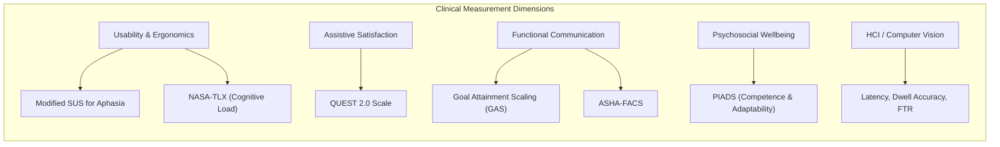

# 📊 Validated Clinical Evaluation Scales & Measurement Battery

> **Document Class:** Clinical Measurement Toolkit  
> **Target Audience:** Clinical Investigators, Speech-Language Pathologists (SLPs), Health Economists, Usability Researchers.

---

## 1. Overview of Outcome Measurement in AAC

To satisfy medical organizations, hospital procurement committees, and clinical guidelines, assistive software cannot rely solely on standard software telemetry. It must be evaluated using **validated psychometric, functional, and quality-of-life instruments** recognized by bodies like ASHA and the WHO.

The following standardized batteries are integrated into Lisan's clinical validation protocol:

---

## 2. Standardized Clinical Instruments

### 2.1 QUEST 2.0 (Quebec User Evaluation of Satisfaction with Assistive Technology)
* **Citation:** Demers, L., Weiss-Lambrou, R., & Ska, B. (2002). The Quebec User Evaluation of Satisfaction with Assistive Technology (QUEST 2.0): An overview and recent progress. *Technology and Disability*, 14(3), 101-105.
* **Format:** 12 items rated on a 5-point Likert scale (1 = Not satisfied at all, 5 = Very satisfied).
* **Core Domains Evaluated:**
  * **Device Subscale:** Dimensions/size, weight, adjustments, safety, durability, ease of use, comfort, effectiveness.
  * **Services Subscale:** Delivery process, repairs/servicing, professional services, follow-up.
* **Application in Lisan:** Administered at 4 weeks and 12 weeks post-deployment to measure patient and caregiver satisfaction with tactile and gesture controls.

---

### 2.2 Modified System Usability Scale (SUS) for Aphasia
* **Citation:** Brooke, J. (1996). SUS: A 'quick and dirty' usability scale. Adapted with visual analog scales and pictorial anchors for people with aphasia (PWA).
* **Format:** 10 core items adapted into simplified, affirmative language accompanied by pictorial smile-to-frown Likert scales:
  1. I think that I would like to use Lisan often.
  2. I found Lisan unnecessarily complex.
  3. I thought Lisan was easy to use.
  4. I think that I would need the support of a technical person to be able to use Lisan.
  5. I found the various functions in Lisan were well integrated.
  6. I thought there was too much inconsistency in Lisan.
  7. I would imagine that most people would learn to use Lisan very quickly.
  8. I found Lisan very cumbersome to use.
  9. I felt very confident using Lisan.
  10. I needed to learn a lot of things before I could get going with Lisan.
* **Benchmark Target:** Score > 80.3 (Grade A / Top 10th percentile of medical software usability).

---

### 2.3 PIADS (Psychosocial Impact of Assistive Devices Scale)
* **Citation:** Day, H., & Jutai, J. (1996). Measuring the psychosocial impact of assistive devices: the PIADS. *Canadian Journal of Rehabilitation*, 9(2), 159-168.
* **Dimensions:**
  1. **Competence (12 items):** Evaluates feelings of capability, efficiency, productivity, and independence.
  2. **Adaptability (6 items):** Evaluates willingness to try new things, participate in family life, and take risks.
  3. **Self-esteem (8 items):** Evaluates feelings of dignity, security, self-confidence, and happiness.
* **Scoring:** Rated from -3 (maximum negative impact) through 0 (no impact) to +3 (maximum positive impact).
* **Clinical Significance:** Directly captures whether Lisan restores personal dignity (reducing the helplessness often caused by stroke or dementia).

---

### 2.4 Goal Attainment Scaling (GAS) for Communication Interventions
* **Citation:** Kiresuk, T. J., & Sherman, R. E. (1968). Goal attainment scaling: A general method for evaluating comprehensive community mental health programs.
* **Clinical Application:** Each patient, together with their SLP and family, defines 3 individualized communication goals prior to trial onset:
  * **-2:** Much less than expected outcome (e.g., patient remains completely passive, communicates only via crying or withdrawal).
  * **-1:** Less than expected outcome (e.g., patient uses Lisan only when physically handed the tablet by caregiver).
  * **0:** Expected outcome (e.g., patient independently uses Lisan 3 times daily to express physiological needs like water, food, or restroom).
  * **+1:** Greater than expected outcome (e.g., patient initiates conversational phrases or expresses emotion using familiar voice packs unprompted).
  * **+2:** Much greater than expected outcome (e.g., patient navigates between gesture mode and grid mode independently, engaging with visiting family members).

---

### 2.5 ASHA-FACS (Functional Assessment of Communication Skills for Adults)
* **Citation:** Frattali, C. M., et al. (1995). American Speech-Language-Hearing Association.
* **Relevant Subdomains:**
  1. Social Communication (greeting family, expressing emotions, answering questions).
  2. Communication of Basic Needs (requesting medication, expressing pain, asking for assistance).
  3. Daily Planning (expressing schedule preferences, prayer times, rest intervals).

---

## 3. Human-Computer Interaction (HCI) Quantitative Metrics

For engineering and technical validation during clinical trials, the following objective computational metrics are logged locally:

| Metric | Target Clinical Benchmark | Method of Measurement |
| :--- | :--- | :--- |
| **Time-to-Expression (TTE)** | < 12 seconds for basic need composition | Timer starting from first landmark/touch event until speech playback completion. |
| **Keystroke / Action Savings Rate (KSR)** | > 45% reduction vs unassisted input | Ratio of actual inputs triggered versus full character length of expressed phrase. |
| **Gesture Dwell Accuracy** | > 92% intentional selection accuracy | Ratio of confirmed intentional gestures to canceled/retracted dwells. |
| **False Positive Rate (FPR)** | < 0.05 unintended triggers per 10 minutes | Monitoring inadvertent trigger events during natural resting periods. |
| **On-Device Inference Frame Rate** | ≥ 24 FPS sustained on mid-tier hardware | In-browser Performance API metrics for MediaPipe landmark extraction loops. |
