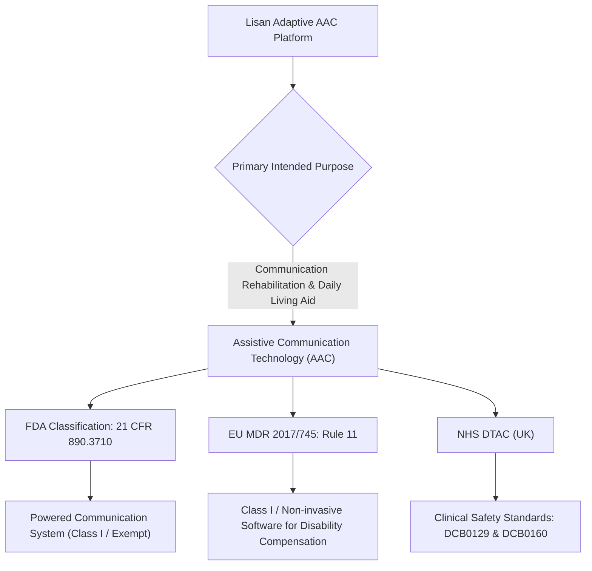
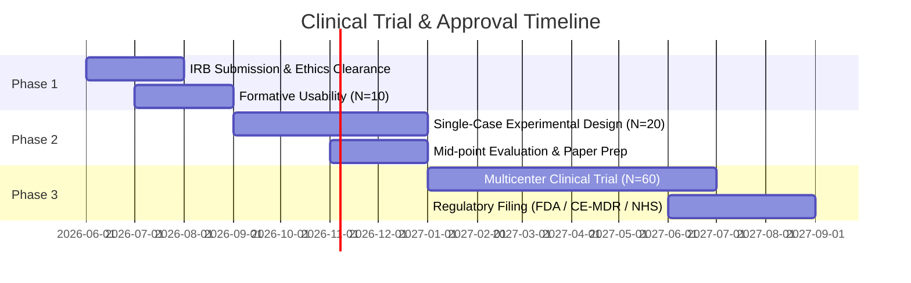

# 🏥 Clinical Validation & Medical Device Approval Roadmap

> **Document Class:** Regulatory & Clinical Strategy Protocol  
> **Target Approvals:** FDA SaMD (Class I / Exempt or 510(k) Pre-Market Notification), EU MDR (2017/745), NHS DTAC (Digital Technology Assessment Criteria), WHO Assistive Health Technology Registry.

---

## 1. Regulatory Categorization (SaMD)

Software intended for medical or clinical communication must be classified under international **Software as a Medical Device (SaMD)** frameworks defined by the **International Medical Device Regulators Forum (IMDRF)**.

### 1.1 Classification Details
* **United States (FDA):**
  * **Product Code:** LZR (Speech Generating Device / Augmentative Communication Device).
  * **Regulation Number:** 21 CFR 890.3710 (*Powered Communication System*).
  * **Classification:** Class I (General Controls), typically 510(k) exempt when marketed for general communication assistance without diagnostic claims.
* **European Union (EU MDR 2017/745):**
  * **Rule 11 (Software):** Class I medical device for the compensation of an injury or handicap (Article 2(1)).
  * **Conformity Assessment:** Self-declaration of conformity (CE mark) with comprehensive Technical Documentation (Annex II & III).
* **United Kingdom (NHS DTAC):**
  * Must satisfy the **Digital Technology Assessment Criteria**:
    1. Clinical Safety (DCB0129 Clinical Risk Management by Manufacturer).
    2. Data Protection (GDPR, Data Protection Impact Assessment - DPIA).
    3. Technical Security (OWASP Top 10, Local Encryption).
    4. Interoperability (Exportable communication logs / FHIR compatibility where applicable).
    5. Usability & Accessibility (WCAG 2.2 AA / AAA compliance).

---

## 2. Applicable Harmonized Standards

To secure medical organization endorsements and hospital deployments, Lisan is designed to align with the following core biomedical engineering standards:

| Standard | Title | Application to Lisan | Status / Implementation |
| :--- | :--- | :--- | :--- |
| **ISO 14971:2019** | *Application of risk management to medical devices* | Risk analysis of communication failure, false positive gesture triggers, and auditory distress. | Documented in Section 3 (FMEA Matrix) |
| **IEC 62304:2006 + A1:2015** | *Medical device software — Software life cycle processes* | Software architecture, unit testing, traceability, and version control for SaMD Class A/B. | Managed via TypeScript static typing, Vitest test suites, and Git semantic versioning |
| **IEC 62366-1:2015** | *Application of usability engineering to medical devices* | Usability testing with elderly patients, cognitive workload assessments, and ergonomic safeguards. | Integrated into Accessibility & Interaction Matrix |
| **ISO 9241-210:2019** | *Human-centred design for interactive systems* | Co-design protocols involving caregivers, speech-language therapists, and stroke survivors. | Embedded in Lisan Design System |
| **WCAG 2.2 Level AAA** | *Web Content Accessibility Guidelines* | High contrast, keyboard navigation, motor disability accessibility, focus states. | Core frontend CSS & Tailwind accessibility tokens |

---

## 3. Medical Device Risk Management (ISO 14971 FMEA Matrix)

The Failure Mode and Effects Analysis (FMEA) identifies potential risks associated with automated or vision-driven AAC and defines engineering mitigations:

| Hazard ID | Failure Mode | Clinical Severity (1-5) | Probability (1-5) | Risk Level | Engineering & UX Mitigation | Residual Risk |
| :--- | :--- | :--- | :--- | :--- | :--- | :--- |
| **HAZ-001** | **False Positive Gesture Trigger:** Involuntary tremor or myoclonus triggers unwanted emergency or medical distress alert. | 4 (High) | 3 (Moderate) | Medium | **Dwell-Time Gating & Confirmation Dialog:** Gestures require minimum sustained hold (e.g. 800ms) with visible circular progress feedback before state executes. | Low (Acceptable) |
| **HAZ-002** | **Cognitive Fatigue / Visual Sensory Overload:** High grid density causes frustration and abandonment in dementia patients. | 3 (Moderate) | 4 (High) | Medium | **Adaptive Grid Density & Progressive Disclosure:** Default view presents max 4–6 high-contrast macro-tiles with automatic simplification based on cognitive mode. | Low (Acceptable) |
| **HAZ-003** | **Biometric / Speech Privacy Leakage:** Voice recordings of bedside family speech leaked to unauthorized servers. | 5 (Critical) | 1 (Rare) | Medium | **100% Offline-First Architecture:** Zero network requests for inference; all IndexedDB tables encrypted on-device; no cloud analytics telemetry. | Negligible |
| **HAZ-004** | **Battery Depletion / High Thermal Load from CV:** Extended webcam MediaPipe tracking causes tablet shutdown during emergency need. | 4 (High) | 2 (Low) | Medium | **Dynamic Frame Rate Throttling & Sleep Mode:** Camera stream drops to 5-10 FPS during idle periods; auto-sleep triggers after 2 minutes of inactivity. | Low (Acceptable) |
| **HAZ-005** | **Misinterpreted Doodle:** Patient draws medicine, AI mispredicts food, delaying critical pain relief. | 4 (High) | 3 (Moderate) | Medium | **Dual-Verification Audio-Visual Prompt:** AI suggestions display top-3 candidate tiles with audio preview before firing final vocalization. | Low (Acceptable) |

---

## 4. Multi-Phase Clinical Investigation Protocol

### Phase 1: Formative Usability & Safety Study (N = 10–12 dyads)
* **Cohort:** 6 individuals with chronic post-stroke aphasia + 6 elderly individuals with mild-to-moderate dementia, each paired with a primary caregiver (dyads).
* **Setting:** Outpatient Speech & Hearing Clinics and Residential Care Facilities.
* **Primary Objective:** Ergonomic safety, interface learnability, error rates, and qualitative caregiver feedback.
* **Instruments:**
  * System Usability Scale (SUS) modified for aphasia.
  * NASA-TLX (Task Load Index) for caregiver burden evaluation.

### Phase 2: Single-Case Experimental Design (SCED) (N = 15–20)
* **Methodology:** Concurrent Multiple Baseline Design Across Participants (standard behavioral clinical paradigm for AAC research recognized by ASHA).
* **Duration:** 12 weeks (3 weeks baseline A, 6 weeks intervention B with Lisan, 3 weeks maintenance A').
* **Primary Outcomes:**
  * **Communication Breakdown Frequency:** Daily tally of unresolved communicative attempts reported by caregivers.
  * **Goal Attainment Scaling (GAS):** Clinician-rated functional milestones (e.g., patient successfully initiates thirst/pain notification unprompted).
  * **Quebec User Evaluation of Satisfaction with Assistive Technology (QUEST 2.0).**

### Phase 3: Longitudinal Multicenter Clinical Efficacy Trial (N = 60+)
* **Setting:** 3 regional hospitals / rehabilitation centers across diverse linguistic cohorts (English, Urdu/Hindi, Arabic).
* **Comparison Group:** Standard low-tech picture communication boards (PECS / paper charts) vs. Lisan Adaptive AAC.
* **Endpoints:**
  * ASHA FACS (Functional Assessment of Communication Skills).
  * Psychosocial Impact of Assistive Devices Scale (PIADS).
  * Patient Health Questionnaire (PHQ-9) depression score alterations.

---

## 5. Medical Organization Endorsement Checklist

To present Lisan to bodies such as the **American Speech-Language-Hearing Association (ASHA)**, the **British Aphasiology Society (BAS)**, or national ministries of health:

- [x] Documented Clinical Evidence Base mapping each feature to peer-reviewed literature ([`research/EVIDENCE_BASE.md`](file:///Users/alhamdulillah/codespace/lisan/research/EVIDENCE_BASE.md))
- [x] Downloaded academic research papers and foundational preprints ([`research/papers/`](file:///Users/alhamdulillah/codespace/lisan/research/papers))
- [x] ISO 14971 Medical Device Risk Analysis & FMEA Matrix
- [x] Validated Clinical Measurement Instruments & Scales ([`research/CLINICAL_EVALUATION_SCALES.md`](file:///Users/alhamdulillah/codespace/lisan/research/CLINICAL_EVALUATION_SCALES.md))
- [x] Institutional Review Board (IRB) Ethics Protocol & Accessible Informed Consent ([`research/ETHICS_AND_IRB.md`](file:///Users/alhamdulillah/codespace/lisan/research/ETHICS_AND_IRB.md))
- [ ] Registered clinical trial on ClinicalTrials.gov (Target: Post-Phase 1 IRB approval)
- [ ] Published Phase 1 & Phase 2 results in an open-access medical journal (e.g. *American Journal of Speech-Language Pathology*, *Frontiers in Digital Health*, *PLOS Digital Health*).
