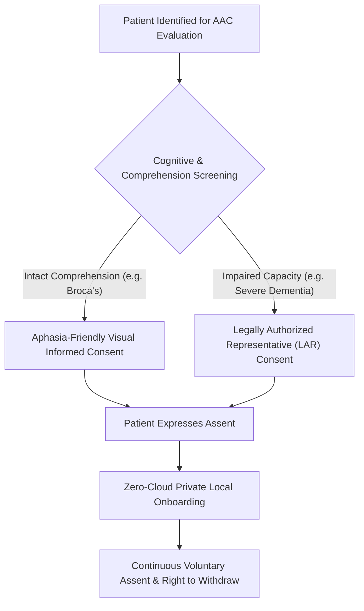

# 🛡️ Human Research Ethics & IRB Protocol Framework

> **Document Class:** Institutional Review Board (IRB) Protocol & Ethics Guide  
> **Applicable Principles:** Declaration of Helsinki (2013), Belmont Report, ICH-GCP (E6 R2), HIPAA Privacy Rule, GDPR Article 9.

---

## 1. Vulnerable Population Protections

Participants involved in clinical evaluations of Lisan frequently belong to vulnerable populations:
1. Adults with acquired language disorders (stroke-induced expressive or receptive aphasia).
2. Geriatric individuals with progressive neurodegenerative conditions (dementia, Alzheimer's disease).
3. Individuals with physical motor deficits (hemiplegia, ALS, locked-in/limited mobility).

To prevent exploitation, coercion, or undue distress, all research adhering to this protocol enforces strict ethical safeguards.

---

## 2. Aphasia-Friendly Informed Consent Protocol

Traditional dense, legalistic 10-page consent forms violate ethical principles when presented to individuals with language disorders. In accordance with guidelines from the *Academy of Neurologic Communication Disorders and Sciences (ANCDS)*:

### 2.1 Consent Design Principles
* **Visual Formatting:** Large font (≥ 18pt), high-contrast layout, generous white space, and bold keywords.
* **Pictographic Support:** Every key research concept (e.g., webcam recording, tablet use, voice recording, ability to stop at any time) is paired with a clear, unambiguous pictogram.
* **Simplified Linguistic Syntax:** Short sentences in active voice (Subject-Verb-Object), eliminating subordinate clauses and clinical jargon.
* **Dual-Channel Administration:** An SLP or trained investigator reads each bullet aloud while simultaneously pointing to the visual illustration, allowing the participant to point, nod, or use gesture confirmation.

### 2.2 Capacity Assessment & Surrogate Consent
* If a participant cannot demonstrate comprehension of the study's purpose and risks despite aphasia-friendly accommodations, consent must be obtained from a **Legally Authorized Representative (LAR)** or primary family caregiver.
* **Ongoing Assent:** Even with LAR consent, the participant retains the right to assent or dissent. Any indication of distress, physical turning away, or agitation immediately halts the session without penalty.

---

## 3. Data Protection, Privacy & Zero-Cloud Architecture

Medical organizations mandate that patient data—especially identifiable biometrics and bedside recordings—be handled with absolute confidentiality.

### 3.1 Biometric Video Stream Privacy
* **On-Device Execution:** All MediaPipe facial mesh and hand tracking computations occur in the client browser's WebAssembly / WebGL runtime.
* **No Video Persistence:** Webcam video frames are consumed in volatile RAM for landmark coordinate calculation and are immediately garbage-collected. No raw video or image frames are ever written to disk or transmitted across any network interface.

### 3.2 Voice Studio Recordings
* Family recordings used in the Voice Studio remain stored strictly inside the device's local **IndexedDB** database.
* **Zero Telemetry / Zero Cloud Sync:** Lisan does not transmit audio files to cloud servers. If the family wishes to transfer voice packs between devices, this is accomplished via manual, encrypted offline export/import (JSON/binary bundle) controlled entirely by the user.

### 3.3 Regulatory Compliance
* **HIPAA Compliance:** Conforms with the Security Rule (45 CFR Part 160 and Part 164) through data minimization, local encryption at rest, and absence of external data transmission.
* **GDPR Article 9 (Special Category Health Data):** Satisfies explicit consent requirements and enforces data sovereignty by design and by default.

---

## 4. Mitigation of Psychological Distress & Agitation

1. **Combating Rejection and Demoralization:** When an AAC device misinterprets an expression or proves difficult to use, patients may feel increased hopelessness. Lisan mitigates this through **Errorless Fallbacks**: if a gesture or doodle fails, the system defaults immediately to a simplified, high-contrast 2-button choice ("Yes" / "No" or "Help").
2. **Fatigue Monitoring:** Neurological patients fatigue rapidly. Test sessions are capped at 20-minute active intervals with mandatory rest pauses.
3. **Caregiver Burden Safeguards:** Training sessions ensure caregivers do not feel overwhelmed by technological maintenance. The local-first PWA design requires zero server configuration or subscription management.
