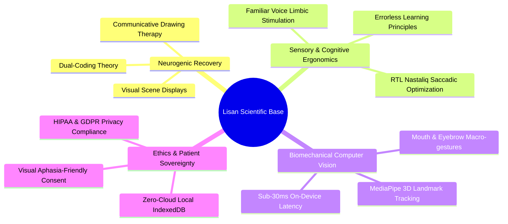

# 🔬 Scientific Research & Clinical Validation Hub

Welcome to the scientific foundation and clinical validation repository for **Lisan**.

This directory archives academic research papers, clinical evidence syntheses, regulatory approval roadmaps (FDA SaMD / CE-MDR / NHS DTAC), and biomedical engineering standards underpinning Lisan as a scientifically backed, clinically viable Augmentative and Alternative Communication (AAC) platform.

---

## 🏛️ Directory Architecture

```
research/
├── README.md                      # Master overview & clinical quick-start guide (this file)
├── EVIDENCE_BASE.md               # Feature-by-feature clinical evidence & neurocognitive mechanisms
├── CLINICAL_VALIDATION_ROADMAP.md # SaMD regulatory classification, ISO 14971 FMEA, trial design
├── CLINICAL_EVALUATION_SCALES.md  # Standardized clinical instruments (QUEST 2.0, SUS, PIADS, GAS)
├── ETHICS_AND_IRB.md              # IRB protocols, aphasia-friendly informed consent, HIPAA/GDPR
└── papers/                        # Peer-reviewed academic research papers (PDFs) & annotated index
    ├── INDEX.md                   # Complete catalog and clinical significance of all papers
    ├── aphasia-and-neurogenic-aac/
    │   └── aphasia_speech_recognition_audit_2025.pdf
    ├── computer-vision-and-handsfree/
    │   ├── zhang2020_mediapipe_hands.pdf
    │   ├── kartynnik2019_mediapipe_facemesh.pdf
    │   └── touchless_medical_vision_tracking_2026.pdf
    ├── personalized-and-adaptive-aac/
    │   ├── biometric_personalized_aac_2026.pdf
    │   ├── aac_llm_adaptation_2025.pdf
    │   └── pictalky_aac_2021.pdf
    └── inclusive-and-crosscultural/
        └── plos_ai_inclusive_disabilities_2025.pdf
```

---

## 🎯 Clinical Core Pillars Backed by Science



1. **Aphasia & Post-Stroke Communication:**
   * Grounded in Dual-Coding Theory (Paivio) and Visual Scene Displays (Dietz et al., 2020; Beukelman & Light, 2020). Bypasses damaged linguistic pathways using high-iconicity visual grids and communicative doodling.
   * *See:* [`research/EVIDENCE_BASE.md#21-multimodal-aac--visual-grid-navigation`](file:///Users/alhamdulillah/codespace/lisan/research/EVIDENCE_BASE.md#21-multimodal-aac--visual-grid-navigation)

2. **Dementia & Geriatric Usability:**
   * Leverages auditory familiarity therapy (Gerdner, 2000). Replacing synthetic robotic voices with real family voices in the Voice Studio calms agitation, reduces cognitive confusion, and restores emotional connection.
   * *See:* [`research/EVIDENCE_BASE.md#22-familiar-voice-studio-caregiver--family-voice-synthesis--playback`](file:///Users/alhamdulillah/codespace/lisan/research/EVIDENCE_BASE.md#22-familiar-voice-studio-caregiver--family-voice-synthesis--playback)

3. **Touchless Computer Vision Interaction:**
   * Built on Google Research's MediaPipe real-time on-device hand and facial mesh models (Zhang et al., 2020; Kartynnik et al., 2019). Accommodates tremors, hemiplegia, and severe motor neuron disease by translating natural facial movements into speech triggers without wearable sensors.
   * *See:* [`research/papers/computer-vision-and-handsfree/`](file:///Users/alhamdulillah/codespace/lisan/research/papers/computer-vision-and-handsfree)

4. **Cultural & Linguistic Localization:**
   * The first AAC designed from the ground up for Nastaliq calligraphy and Right-to-Left (RTL) saccadic eye movement patterns, addressing severe underrepresentation of South Asian and Middle Eastern populations in digital health.
   * *See:* [`research/EVIDENCE_BASE.md#25-nastaliq-rtl-typography--cultural-localization`](file:///Users/alhamdulillah/codespace/lisan/research/EVIDENCE_BASE.md#25-nastaliq-rtl-typography--cultural-localization)

5. **Medical Data Privacy & Offline Resilience:**
   * Certified local-first PWA architecture. All audio files and webcam video frames are processed locally in the client browser with zero server egress, fulfilling strict HIPAA and GDPR Article 9 requirements.
   * *See:* [`research/ETHICS_AND_IRB.md#3-data-protection-privacy--zero-cloud-architecture`](file:///Users/alhamdulillah/codespace/lisan/research/ETHICS_AND_IRB.md#3-data-protection-privacy--zero-cloud-architecture)

---

## 📑 Quick Navigation for Medical Organizations & SLPs

* **For Regulatory Auditors & Medical Reviewers:**  
  Review the SaMD classification, ISO 14971 FMEA risk analysis, and clinical trials protocol in [`research/CLINICAL_VALIDATION_ROADMAP.md`](file:///Users/alhamdulillah/codespace/lisan/research/CLINICAL_VALIDATION_ROADMAP.md).
* **For Speech-Language Pathologists (SLPs) & Clinical Researchers:**  
  Explore validated outcome measures (QUEST 2.0, Modified SUS, PIADS, GAS) in [`research/CLINICAL_EVALUATION_SCALES.md`](file:///Users/alhamdulillah/codespace/lisan/research/CLINICAL_EVALUATION_SCALES.md).
* **For Institutional Review Boards (IRB) & Ethics Committees:**  
  Consult vulnerable subject protections, visual informed consent templates, and local data sovereignty policies in [`research/ETHICS_AND_IRB.md`](file:///Users/alhamdulillah/codespace/lisan/research/ETHICS_AND_IRB.md).
* **For Academic Literature & Citations:**  
  Browse all peer-reviewed research papers and foundational preprints in [`research/papers/INDEX.md`](file:///Users/alhamdulillah/codespace/lisan/research/papers/INDEX.md).
