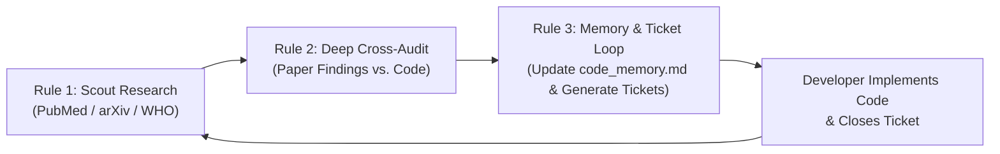

# 🩺 Research Scout & Clinical Codebase Audit Skill

This skill enforces a rigorous, 3-phase scientific cycle to ensure that **Lisan** is continuously backed by peer-reviewed research, medical device standards (FDA SaMD, CE-MDR, NHS DTAC), and neurocognitive evidence.



---

## 📜 Rule 1: Searching New Groundbreaking Research (Scout & Acquire)

When evaluating new features or addressing clinical conditions (e.g., aphasia, dementia, shingles pain, stroke dysarthria, motor neuron diseases):

1. **Target Primary High-Impact Repositories:**
   * **PubMed / PubMed Central (PMC):** For peer-reviewed clinical trials, speech pathology guidelines (ASHA), and systematic reviews.
   * **arXiv (cs.HC, cs.CV, cs.AI):** For cutting-edge on-device computer vision models, gesture tracking, and adaptive predictive text.
   * **Global Regulatory & Clinical Bodies:** WHO Assistive Technology guidelines, FDA SaMD guidance, NHS Digital Technology Assessment Criteria (DTAC).
2. **Download Verified Open-Access PDFs:**
   * Store the full scientific PDF under the appropriate category in:
     `research/papers/<category>/<author_year_slug>.pdf`
   * Supported categories:
     * `aphasia-and-neurogenic-aac`
     * `computer-vision-and-handsfree`
     * `personalized-and-adaptive-aac`
     * `inclusive-and-crosscultural`
3. **Register in Master Index:**
   * Update [`research/INDEX.md`](file:///Users/alhamdulillah/codespace/lisan/research/INDEX.md) and [`research/papers/INDEX.md`](file:///Users/alhamdulillah/codespace/lisan/research/papers/INDEX.md):
     * Paper metadata (Title, Authors, Journal/Venue, Year, DOI/Identifier).
     * **The X-Factor:** Why this research was chosen over conventional methods.
     * **Direct Implementation:** Exactly which Lisan module or UI pattern adopts this finding.
     * **Medical Conversation Notes:** Specific points for communicating with doctors, SLPs, and IRBs.

---

## 🔍 Rule 2: Extensively Reading Through Research & Code (The Reality Check)

Never accept a feature claim without reading both the scientific paper's methodology and the actual application source code:

1. **Extract Key Clinical Parameters from the Paper:**
   * What is the patient population? (e.g. Broca's aphasia, stage 4 Alzheimer's, postherpetic neuralgia).
   * What cognitive or physical mechanisms are identified? (e.g., dual-coding, saccadic eye scan, 4–7 Hz tremor, errorless learning, familiar auditory stimulation).
   * What are the proven latency, error rate, or usability thresholds? (e.g. dwell time ≥ 800ms, contrast ratio ≥ 7:1, on-device latency < 30ms).
2. **Perform Line-by-Line Code Audit:**
   * Inspect the corresponding components in `src/`:
     * State management & database (`src/lib/universeDb.ts`, `src/lib/vocabularyStore.ts`)
     * Machine vision & recognition pipelines (`src/recognition/`, `src/components/GestureService.tsx`)
     * Linguistic & audio engines (`src/hooks/useLanguage.tsx`, `src/hooks/useAudio.ts`, `src/lib/predictionsEngine.ts`)
     * UI presentation & interaction ergonomics (`src/components/WordCard.tsx`, `src/components/WordGrid.tsx`, `src/components/SentenceBuilder.tsx`)
3. **Identify Discrepancies & Bottlenecks:**
   * Does the UI violate the paper's findings? (e.g. immediate jarring robotic speech when the paper says familiar voice with calming pacing delay).
   * Does the code omit error recovery loops?
   * Are mother tongue / low-resource language scripts properly rendered?

---

## 📝 Rule 3: Finding Missing Pieces, Updating `code_memory.md`, & Creating File Tickets

Whenever a clinical gap is identified between the research and the code:

### 3.1 Append Findings to `research/code_memory.md`
Update [`research/code_memory.md`](file:///Users/alhamdulillah/codespace/lisan/research/code_memory.md) under **Part 2: Codebase Audit**:
* Document the clinical need.
* Document the current code state.
* Clearly describe the missing code piece.
* Update instructions from both perspectives:
  1. **Research Mentor to CEO:** Regulatory stance, trial design, clinical authority.
  2. **Product Manager to Senior Engineer:** Acceptance criteria and architecture.

### 3.2 Create Actionable File Tickets in `research/tickets/`
Generate a standalone Markdown ticket file in `research/tickets/` using the standard format:
`research/tickets/TICKET-XXX-description.md`

#### Ticket File Format:
```markdown
# 🎫 Ticket: [TICKET-ID] [Title]
**Priority:** [CRITICAL / HIGH / MEDIUM / LOW]  
**Status:** [OPEN / IN_PROGRESS / RESOLVED]  
**Clinical Grounding:** [Link to Paper in research/papers/ or Section in research/INDEX.md]  
**Target Files:**
- `path/to/file1.ts`
- `path/to/file2.tsx`

## 1. Problem Statement & Clinical Context
[Describe why the current code fails the clinical requirement]

## 2. Technical Specification
[Exact data structures, UI changes, algorithms to implement]

## 3. Acceptance Criteria
- [ ] Criterion 1
- [ ] Criterion 2
- [ ] Tested on target hardware / simulated viewport

## 4. Lifecycle Action
Once the code changes are implemented and verified via unit tests/visual inspection, **delete or archive this ticket file** and update `research/code_memory.md`.
```

---

## ⚡ Quick-Run Checklist for the Agent

When tasked with a new research-to-code iteration:
1. `search_web` / query arXiv or PubMed for open-access PDF.
2. Download PDF to `research/papers/<category>/`.
3. Read the PDF findings and read the corresponding code in `src/`.
4. Update `research/INDEX.md` and `research/papers/INDEX.md`.
5. Append new insights to `research/code_memory.md`.
6. Create `research/tickets/TICKET-<id>.md`.
7. Once the user or developer finishes implementing the feature in code, delete the ticket file.
